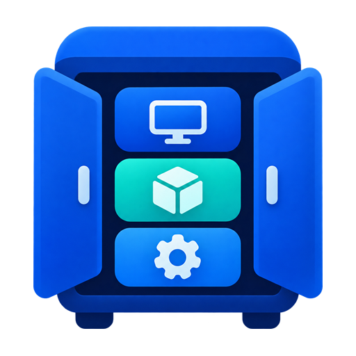

# WinGetCatalogue



WinGetCatalogue is a Windows desktop app for exploring the WinGet community source. It’s built with C#, .NET 10, and WinUI 3, and packaged as MSIX.

## Why I built WinGetCatalogue

I’m Patrick, the creator and maintainer of WinGetCatalogue. [@patricks77 on GitHub](https://github.com/patricks77)

I started this project because I found the WinGet catalogue hard to browse. I wanted an experience like a Linux software centre, where I could pick a category, narrow it down, and discover useful apps I hadn’t thought to search for.

## Download

The [v0.1.0 preview](https://github.com/patricks77/WinGetCatalogue/releases/tag/v0.1.0) includes a Windows x64 MSI and a **Source code (zip)** archive. Download and open `WinGetCatalogue-0.1.0-win-x64.msi`, then start **WinGetCatalogue** from the Start menu.

The GitHub preview was tested on Windows 11 x64. The MSI is unsigned, so Windows or your organization’s policy may warn about it or block it. The installer includes .NET and the Windows App SDK runtime. If your PC lacks the Visual C++ runtime, get the latest x64 redistributable from Microsoft. [Microsoft Visual C++ Redistributable](https://learn.microsoft.com/cpp/windows/latest-supported-vc-redist)

## What you can do

- Browse a grid of apps organized into categories and subcategories, including Internet, Multimedia, Office & productivity, Creative, Development, and Games.
- Search by name, publisher, alias, or WinGet package ID while keeping your category and subcategory filters.
- Open an app family to see its individual packages. Each package has its own WinGet ID and installation command.
- Inspect the publisher, description, and icon when WinGet provides them. Details and icons are fetched in the background and cached locally.
- Copy the PowerShell installation command from a package's details, or select **Install with WinGet** to run it.
- Open **Installed software** to see versions and available updates reported by WinGet's community and Microsoft Store sources. Use **Updates available** to narrow the list.

## Catalogue and updates

The discovery grid reads Microsoft's WinGet community index. The app checks for a new index at startup and periodically while it runs. **Refresh** in the catalogue also checks for new and changed packages. The app stores the last downloaded index and fetched package details and icons in SQLite so you can browse cached content offline after the first successful sync. The [WinGet community repository](https://github.com/microsoft/winget-pkgs) documents where the package manifests come from.

Categories use WinGet metadata and local classification rules first. Bundled corrections and version-specific suggestions fill gaps. Some packages will still appear under **Other software**. Maintainers update the bundled classifications with app releases, while the catalogue itself can discover new packages between releases. The app runs without an AI service or model.

The Microsoft Store source is used for the installed inventory and update checks. Availability and installability depend on WinGet's sources and your device. Installers are delivered by WinGet.

## Build and run locally

Use a Windows development machine with the .NET 10 SDK and Visual Studio 2026 with the **WinUI application development** workload. Enable **Developer Mode** for local package registration. [Microsoft's WinUI setup guide](https://learn.microsoft.com/windows/apps/windows-app-sdk/set-up-your-development-environment) covers these prerequisites.

Open `WinGetCatalogue.slnx` in Visual Studio, select **x64** on an x64 PC, and run the **WinGetCatalogue (Package)** profile. You can also build and launch from PowerShell in the source directory.

```powershell
dotnet build WinGetCatalogue.slnx -p:Platform=x64
dotnet run --project WinGetCatalogue.csproj -p:Platform=x64 -p:WinAppRunDevTools=off
```

The run command registers and starts the local development package. The solution also includes ARM64 and x86 platform configurations.

For installation, installed inventory, and updates, the app needs WinGet from Microsoft App Installer. If the startup check fails, select **Open App Installer**, install or update it in the Store, then use **Check again** if needed. Catalogue browsing remains available. [Microsoft's App Installer guide](https://learn.microsoft.com/windows/msix/app-installer/install-update-app-installer) includes setup options for PCs without Store access.

## Report a problem

- **Wrong category** — Open the package details, choose **Report an incorrect category**, and copy or save the report. Include the WinGet ID and suggested category when sharing it with this project.
- **Failed installation** — For supported WinGet errors, the package details can prepare a report for Microsoft's `winget-pkgs` repository. Review the draft and its diagnostics before submitting it.

## Project layout

| Area | Files |
| --- | --- |
| WinUI views and interactions | `MainPage.xaml`, `MainPage.xaml.cs` |
| Index refresh and package details | `CatalogSource.cs`, `WinGetDetails.cs`, `PackageDetailsCache.cs` |
| Search, grouping, and categories | `SoftwareCatalog.cs`, `CatalogApplication.cs`, `CatalogCategory.cs`, `CatalogSubcategory.cs` |
| Installed inventory and WinGet commands | `InstalledSoftware.cs`, `WinGetCommand.cs` |
| Classification data and maintenance | `Data/`, `docs/classification-maintenance.md` |
| GitHub installer | `packaging/WinGetCatalogue.wixproj`, `packaging/WinGetCatalogue.wxs` |

## Release status

The GitHub MSI is a public preview. The Visual Studio solution also builds the packaged MSIX app, and Microsoft Store distribution is planned. The [installer build notes](packaging/README.md) document how to reproduce the GitHub installer.
